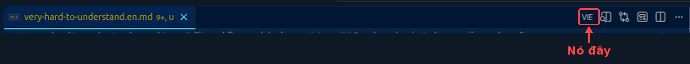

# VIE-markdown 🇻🇳

**AI gen ra 47 file Markdown trong một buổi chiều. Bạn đọc chưa hết file đầu thì file thứ 12 đã đẻ thêm 3 file con.**

Đã ruk còn toàn tiếng Anh. Đọc đến đoạn thứ ba là đầu óc bắt đầu mụ dần, có khi gật đầu bừa rồi giật mình: *"Ủa, nãy mình mới approve cái gì vậy?"*. Dễ bị AI "chơi" ghia! 😵‍💫

Trình English chưa tự tin thì dễ bị AI "chơi" lắm bạn ơi. **Ruk, đọc doc bằng tiếng mẹ đẻ đi cho khỏe.**

### Giải pháp: cái extension này

Bấm **VIE** → file Markdown biến thành tiếng Việt, code block, link, bảng vẫn y nguyên. Xong. Không drama.


- 🆓 **Cần API key free.** Gemini hoặc Groq đều có gói miễn phí, tự đi xin (link ở dưới), 2 phút là xong. (Nhớ free nó sẽ share cho nhà cung cấp AI, dùng cẩn thận nhé! 🫡)
- 💸 Bạn muốn dùng key đã nạp VIP cho sang, cho bảo mật hơn thì... *chuyện của bạn*, author không phán xét or xin ké.
- 🧠 Dịch xong nhớ đọc lại, đừng tin AI mù quáng. Nhưng ít nhất lúc này bạn *đọc hiểu* thứ nó viết.

### 🍜 Vângg, author cũng cần được chăm 🥹

Tool này sinh ra để mình **thoát khỏi chính cái app này**: dịch đỡ mệt rồi đi rèn en-lịt cho đàng hoàng, ngày nào đó không cần extension nữa.
Nên ae, bạn bè xã hội, nếu thấy xài ngon thì **nuôi mình một bữa** để mình có sức học eng nhé T.T

<p align="center">
  
  <br><sub>Quét MoMo, only 10k thôi. Cảm ơn ae nhiều, hứa học en-lịt chăm hơn 🫡</sub>
</p>

---

Dịch file Markdown từ tiếng Anh sang tiếng Việt ngay trong VS Code, dùng Gemini hoặc Groq. Giữ nguyên định dạng Markdown, code block và thuật ngữ kỹ thuật.

> 🏠 **Bản nội bộ:** extension này chưa lên VS Code Marketplace. Team cài thẳng từ repo hoặc từ file `.vsix` author gửi. Làm theo mục dưới, mất khoảng 3 phút.

## Cài đặt (dễ hơn nấu mì gói)

Cần sẵn: [VS Code](https://code.visualstudio.com/) 1.90 trở lên, [Node.js](https://nodejs.org/) bản LTS mới (chỉ khi tự build; tác giả đang dùng v22.22.1).

### Cách 1: Có file `.vsix` rồi (nhanh nhất)

Tải file `vie-markdown-x.y.z.vsix` mới nhất ở trang [Releases](https://github.com/ThanhPhat1080/vie-markdown/releases) (hoặc nhờ author gửi), rồi:

```bash
code --install-extension vie-markdown-x.y.z.vsix
```

Hoặc trong VS Code: `Ctrl+Shift+P` → **Extensions: Install from VSIX…** → chọn file.

### Cách 2: Tự build từ repo

```bash
git clone https://github.com/ThanhPhat1080/vie-markdown.git
cd vie-markdown
npm install
npm run build        # biên dịch TypeScript ra out/
npm run package      # tạo file vie-markdown-x.y.z.vsix
code --install-extension vie-markdown-*.vsix
```

Sau khi cài, chạy **Developer: Reload Window** (`Ctrl+Shift+P`) để VS Code nạp extension.

> `npm run package` không tự build. Nhớ chạy `npm run build` trước, nếu không file `.vsix` chứa code cũ.

### Cập nhật bản mới

`git pull`, rồi chạy lại các bước build, package, cài ở trên (thêm `--force` nếu cùng số phiên bản), rồi Reload Window.

## ⚠️ Quyền riêng tư

Nội dung file được gửi tới provider bạn chọn 🥹🥹(Google Gemini hoặc Groq) để dịch. Với gói miễn phí của Google, dữ liệu có thể được dùng để cải thiện sản phẩm. Đừng dịch file chứa thông tin nhạy cảm (mật khẩu, key, hợp đồng... AI không cần biết).

Tài liệu nội bộ của công ty? Hỏi sếp/security trước khi cho qua API free của bên thứ ba nhé.

## Lấy API key (miễn phí, đừng lo, chưa ai đòi 💵)

- Gemini: https://aistudio.google.com/apikey
- Groq: https://console.groq.com/keys

Nhập key ở một trong hai nơi:

1. Settings (`Ctrl+,` → gõ `vieMarkdown`): ô `vieMarkdown.geminiApiKey` và `vieMarkdown.groqApiKey`. Key lưu chữ thường trong settings.json, nên đặt ở **User settings**, **đừng** để trong `.vscode/settings.json` của repo và đừng commit.
2. Hoặc để extension hỏi khi bạn chọn provider chưa có key; key nhập ở hộp thoại được ghi vào setting tương ứng.

Đổi key bằng lệnh `vie-markdown: Đặt API key Gemini` hoặc `vie-markdown: Đặt API key Groq`. Mỗi người dùng key của chính mình, đừng share key cho nhau.

## Cách dùng

<p align="center">
  
</p>

Mở một file `.md`, rồi:

- bấm nút **VIE** trên thanh tiêu đề của editor (góc trên bên phải), hoặc
- `Ctrl+Shift+P` → gõ `vie-markdown`.

Một danh sách hiện ra để bạn **chọn model** dịch, ví dụ `Gemini · gemini-3.5-flash-lite` hoặc `Groq · qwen/qwen3.8-27b`. Lần chọn trước được xếp lên đầu; mục nào chưa có key sẽ ghi "chưa có API key".

Bản dịch mở trong một tab Markdown mới bên cạnh. Bạn sửa tay được, rồi lưu bằng `Ctrl+S` (ví dụ `ten-file.vi.md`).

Mỗi tiêu đề `#` giữ dòng tiếng Anh gốc, ngay dưới là bản dịch dạng `*Title: ...*` để dễ tìm lại bản gốc.

Extension không tự đổi provider khi lỗi; nếu một provider hết hạn mức hay quá chậm, chạy lại và chọn provider kia.

## Chỉnh cho vừa ý (Settings)

| Setting | Ý nghĩa | Mặc định |
|---|---|---|
| `vieMarkdown.geminiApiKey` | API key Gemini | rỗng |
| `vieMarkdown.groqApiKey` | API key Groq | rỗng |
| `vieMarkdown.model` | Tên model Gemini | `gemini-3.5-flash-lite` |
| `vieMarkdown.groqModel` | Tên model Groq | `qwen/qwen3.8-27b` |
| `vieMarkdown.keepTerms` | Danh sách từ giữ nguyên tiếng Anh, không dịch | `[]` |

Danh sách model của Groq thay đổi theo thời gian. Gặp lỗi 404 thì xem model đang dùng được bằng `node out/debug.js --list-models --provider groq` (xem mục Phát triển).

## Giới hạn của gói miễn phí

Gói free giới hạn số request và số token mỗi phút/ngày; mức cụ thể do Google/Groq quy định và có thể thay đổi, xem trang chính thức (Google AI Studio, console.groq.com/settings/limits). Khi vượt mức, extension tự chờ và thử lại tối đa 3 lần. Nếu vẫn lỗi, phần đã dịch được giữ trong tab mới, bạn chờ vài phút rồi chạy lại.

Timeout tự tăng theo độ dài đoạn (Gemini 90 giây + 5 ms/ký tự, tối đa 5 phút; Groq 45 giây + 5 ms/ký tự). Với Groq, đoạn dài được chia thành phần ≤ 4000 ký tự để không vượt giới hạn token/phút của gói free, và không chờ quá 20 giây khi bị giới hạn tốc độ.

Bản dịch của AI có thể lệch định dạng. Nếu số tiêu đề, code block hoặc link không khớp bản gốc, extension sẽ hiện cảnh báo.

## Thông báo lỗi và cảnh báo

Mọi thông báo đều nói rõ nguyên nhân (và nêu đúng tên Gemini hay Groq) kèm nút hành động:

| Tình huống | Bạn thấy gì |
|---|---|
| API key sai | Nút **Nhập key mới** cho đúng provider (key cũ trong settings được giữ nguyên cho bạn tự sửa) |
| Model không tồn tại (404) | Nêu tên model, nút mở đúng setting model |
| Hết hạn mức free (429) | Đã thử lại 3 lần (theo gợi ý chờ của nhà cung cấp), nút đổi model |
| Quá tải (5xx) | Tự thử lại 3 lần; nếu vẫn lỗi thì báo mã HTTP |
| Mạng chậm / quá thời gian chờ | Gợi ý thử lại, kiểm tra mạng hoặc chọn model/provider khác |
| Bị bộ lọc an toàn chặn, hoặc bản dịch bị cắt cụt | Nêu rõ **phần** nào bị ảnh hưởng |
| Lỗi giữa chừng | "Đã dịch X/Y phần", phần đã dịch nằm trong tab mới |

Sau khi dịch xong, extension còn cảnh báo:

- **Lệch định dạng**: số tiêu đề, code block hoặc link khác bản gốc.
- **Đoạn chưa dịch**: câu tiếng Anh dài (từ 40 ký tự, từ 6 từ trở lên) còn nguyên trong bản dịch; thông báo trích vài câu đầu để bạn kiểm tra và dịch bổ sung.

Bấm **Xem chi tiết** để mở kênh Output `vie-markdown`: log từng request (model, mã HTTP, thời gian), danh sách đầy đủ các đoạn chưa dịch và lý do lỗi. API key không bao giờ được ghi vào log.

## Phát triển và thử thủ công

```bash
npm install
npm run build
npm test             # chạy bộ test (vitest)
```

**Chạy extension từ source (F5):** mở repo trong VS Code, nhấn `F5` với cấu hình "Run Extension (đọc key từ .env)". Trong cửa sổ Extension Development Host, mở một file `.md` và bấm **VIE**.

Ở chế độ này extension đọc key từ file `.env` ở thư mục gốc repo (file này đã nằm trong `.gitignore` và `.vscodeignore`):

```
GEMINI_API_KEY=...
GROQ_API_KEY=...
```

`.env` chỉ được đọc khi chạy F5; bản cài từ `.vsix` không đọc nó, và key trong `.env` ưu tiên hơn setting.

**CLI debug (không cần mở VS Code):**

```bash
node out/debug.js markdown.mock.md --dry                      # không gọi mạng, xem số phần và prompt
node out/debug.js markdown.mock.md --provider groq --limit 1500
node out/debug.js markdown.mock.md --provider gemini --limit 1500
node out/debug.js --list-models --provider groq               # model Groq mà key của bạn dùng được
```

CLI tự đọc key từ biến môi trường hoặc `.env` trong thư mục hiện tại, và không in key ra.

## Góp ý, báo lỗi

Gặp lỗi hay muốn thêm tính năng thì nhắn author, hoặc mở issue/PR trên repo nội bộ. Kèm nội dung kênh Output `vie-markdown` (đã được che key) là author vui nhất 🙏
